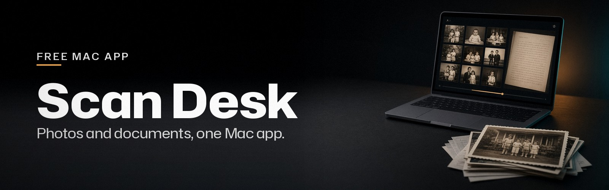

<p align="center">
  
</p>

# Scan Desk

**One free Mac app for scanning photos and documents on the Epson FastFoto FF-680W.**

Epson has you use FastFoto for photos and ScanSmart for documents on the same scanner. I wanted one app that does both, so I made Scan Desk.

[](https://github.com/remymazmanian/scan-desk/releases/latest)
[](LICENSE)
[](#requirements)
[](#requirements)
[](#build-and-run)

Scan Desk is a native macOS app (Swift, SwiftUI) that works with the Epson FastFoto FF-680W. It replaces both Epson FastFoto (photos) and Epson ScanSmart (documents). It talks to the scanner through Apple's Image Capture framework and Epson's official driver (installed with Epson Scan 2), and uses no third-party code. It has no telemetry, and its only network traffic is finding the scanner and scanning from it.

More about the app: [remymazmanian.com/scan-desk](https://remymazmanian.com/scan-desk/).

> This project isn't affiliated with or endorsed by Epson. Epson, FastFoto and ScanSmart are trademarks of their owner.

## Contents

[Features](#features) · [Requirements](#requirements) · [Other scanners](#other-scanners) · [Install](#install) · [Privacy](#privacy) · [Known limits](#known-limits) · [Not supported](#not-supported) · [Build and run](#build-and-run) · [Tests](#tests) · [Layout](#layout) · [License](#license)

## Features

### Photos mode

- **Batch scanning.** Feed a stack of prints and click **Scan**. Thumbnails appear as each photo is saved, with a running count.
- **Cropping and straightening.** The scanner's own auto size detection and deskew handle this. If a page comes back uncropped, the app finds the print against the scanner background itself, using Vision rectangle detection when it agrees.
- **Rotation.** Photos are turned upright automatically using face detection. To fix a photo without faces, right-click its thumbnail and choose **Rotate Left** or **Rotate Right**.
- **Backs (optional).** Saved as `name_b.jpg`. Blank backs are skipped; a back with even one handwritten word is kept.
- **Enhance (optional).** Restores faded color and adds light sharpening. It's saved as `name_e.jpg`, and the untouched original is always kept.
- **Naming.** Files are named like `1998_Summer-Trip_0001.jpg`. Numbering continues from the highest number already in the folder.
- **Resolution and format.** 300 or 600 dpi, saved as JPEG or TIFF (lossless). The scanner outputs 24-bit color, so TIFF gives no extra color depth.
- **Photos app.** Finished photos can go into Photos, either automatically after each batch or with the **Add to Photos** button. The enhanced copy is added when there is one, otherwise the original. Backs aren't added.

### Documents mode

- **Color modes.** Color, grayscale, or black and white, at 300 or 600 dpi, one side or both.
- **Blank pages (optional).** Skipped by the app, because the scanner's own blank-page skip is unreliable.
- **Upside-down pages.** Turned upright by the scanner's text-based auto rotation.
- **Output.** One multi-page PDF with searchable text (recognized on this Mac), or one JPEG or TIFF per page.
- **Naming.** `2026-11-17_Title.pdf`. If a file with that name already exists, `_2`, `_3` and so on are added.
- **Paper size.** Pages up to 8.5 in wide and at least 14 in long (Legal length) scan in full. See [Known limits](#known-limits).

All settings are remembered between launches.

## Requirements

- macOS 15 or later, on Apple Silicon.
- Epson's driver, which comes with Epson Scan 2.
- An Epson FastFoto FF-680W. Scan Desk was built and tested with this model only.

## Other scanners

I built and tested Scan Desk on my FF-680W. It isn't locked to that model. It uses any scanner with a document feeder that macOS Image Capture can see, and a scanner without a feeder gets a "no feeder" message. Epson's driver options, such as auto size, deskew, auto rotate and double-feed detection, are requested by name and skipped if a driver doesn't offer them. Cropping, face-based rotation, blank detection, front/back pairing and PDF text recognition are done by the app, so they work on any scanner's output.

Other Epson feeder models will probably work. Feeder scanners from other brands should scan documents, but photo cropping may need tuning. Flatbed scanners aren't supported.

To test your own model, run the probe in `Probe/` with your scanner's name; [PROBE.md](PROBE.md) explains how. If you try one, please open an issue with what you find. Scan Desk is MIT-licensed, so you can also fork it and adapt it, and pull requests are welcome.

### Tested scanners

| Scanner | Connection | Status |
|---|---|---|
| Epson FastFoto FF-680W | Wi-Fi | Tested |

## Install

1. Download `ScanDesk.zip` from the [v0.1.0 release](https://github.com/remymazmanian/scan-desk/releases/tag/v0.1.0). The [latest release](https://github.com/remymazmanian/scan-desk/releases/latest) page always has the newest version.
2. Unzip it and move **Scan Desk** to your Applications folder.
3. Open it. The app is signed and notarized, so it opens normally.

To check the download, compare its checksum with the one published for the release:

```
shasum -a 256 ScanDesk.zip
```

SHA-256 of `ScanDesk.zip` in v0.1.0:

```
79a98c841c6ffd8fec64bb00d9cf47d4449bc76823aa8a1ab6b93827d1b56522
```

## Privacy

Scan Desk has no telemetry. Its only network traffic is finding the scanner and scanning from it. Text recognition for searchable PDFs happens on your Mac.

## Known limits

- **Paper size:** pages up to 8.5 in wide and at least 14 in long (Legal length) scan in full; the scanner crops each page to its real size. A4 fits inside that but hasn't been run itself. Sheets longer than 14 in are untested.
- **Connection:** tested over Wi-Fi only, not USB.
- **Rotation:** photos without faces aren't turned automatically.
- **Backs:** a back whose only writing is within about half an inch of the edge counts as blank. A back covered in dense writing or print can be mistaken for a new photo; it's still saved, as its own numbered file.
- **Scanner model:** tested with the FF-680W only. See [Other scanners](#other-scanners).

## Not supported

The first three are limits of the scanner or its driver; see [PROBE.md](PROBE.md).

- More than 24-bit color: a hardware limit, so FastFoto can't do it either.
- A scan speed setting.
- The scanner's physical button: it still opens Epson's apps.
- Cloud and email sending.
- Long-paper mode for receipts.

## Build and run

Building needs only the Xcode Command Line Tools. Running the tests uses Xcode if it's installed (see [Tests](#tests)).

```
scripts/build-app.sh            # builds and signs build/Scan Desk.app
scripts/build-app.sh --install  # also copies it to ~/Applications
```

**Signing:** the build script signs with a "Developer ID Application" certificate from the keychain, using the hardened runtime and a secure timestamp. To pick a specific certificate, set `SIGN_IDENTITY` to its SHA-1 hash. Without such a certificate the app is signed ad-hoc and runs only on the Mac that built it.

**Notarizing for distribution:** `NOTARY_PROFILE=<profile> scripts/build-app.sh --notarize` submits the signed app to Apple, staples the ticket, and leaves `build/ScanDesk.zip` ready to share. `<profile>` is a keychain profile created once with `xcrun notarytool store-credentials`. It needs Xcode. Without notarization, a copy downloaded on another Mac is blocked by Gatekeeper.

**Icon:** `swift scripts/make-icon.swift` redraws the icon in code and writes `App/Resources/AppIcon.icns`, which the build script bundles.

## Tests

```
scripts/test.sh
```

The tests generate their own images (synthetic prints, backs, scanner frames and text pages), so they never need real scans. They cover naming, blank and picture detection, cropping, front/back pairing (including backs the scanner drops), enhancement, manual rotation, and searchable PDFs. Automatic face-based rotation needs real photos with faces, so it is checked by hand.

## Layout

| Path | What |
|---|---|
| `App/Sources/ScanKit` | Scanner connection, image processing, PDF, naming, Photos import |
| `App/Sources/ScanDesk` | The SwiftUI app |
| `App/Sources/scankit-check` | Runs the processing on saved raw scans, without a scanner |
| `App/Tests` | Tests on generated images |
| `scripts/` | Build, test and icon scripts |
| `PROBE.md` | What the scanner's driver does and doesn't offer |
| `Probe/` | A command-line probe that lists what the driver exposes and runs test scans |
| `docs/images/` | Banner and preview images used in this README |

## License

MIT. See [LICENSE](LICENSE).
